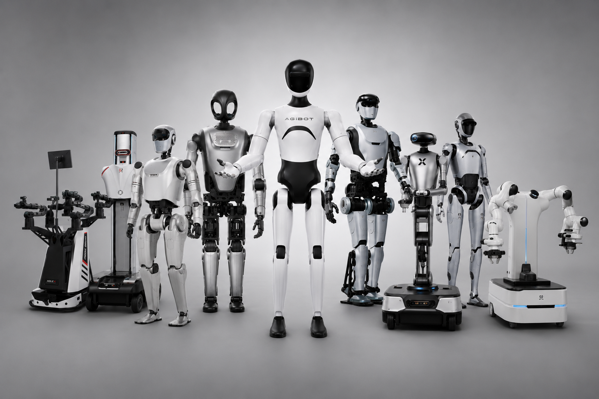

<p align="center">
  
</p>


<h1 align="center">🤖 Hello VLA</h1>

<p align="center">
  <em>快速了解 VLA，跟进前沿研究方向</em>
</p>

<p align="center">
  <strong>It’s amazing what you can learn if you’re not afraid to try.</strong>
</p>

<p align="right">
  <sub><em><font color="#8a8f98">—— Robert A. Heinlein, Have Space Suit–Will Travel</font></em></sub>
</p>


---

</div>


## 写在前面

实践永远是最好的老师。即使是刚刚接触一个领域，我认为最快的学习方式也是先动手实践，再在实践过程中不断补充知识，而不是等到拥有“完美”的知识储备后再开始。

VLA 和世界模型是当前比较热门的研究方向，但面对大量论文和 Awesome 仓库，初学者往往很难判断应该从哪里开始。在这里，我会分享自己阅读过的论文、实践过的项目，以及对它们的理解。

当然，这些内容都带有一定的主观性。如果有错误的地方，欢迎大家纠正；如果你有更好的想法，也欢迎联系我。

📧：[yirongzzz@163.com](mailto:yirongzzz@163.com)


## 📋 目录

| 章节                                 | 描述                                 |
| ------------------------------------ | ------------------------------------ |
| [🚀 快速开始](#-快速开始)             | 帮助初学者快速建立 VLA 认知          |
| [💐 多源数据预训练](#-多源数据预训练) | 多源数据的组织方式与训练 recipe      |
| [🧠 VLA & Memory](#-vla--memory)      | 短期记忆与长期记忆如何辅助长时程任务 |
| [💪 VLA & RL](#-vla--rl)              | 强化学习提升模型的鲁棒性             |
| [📓 VLA & Subtask](#-vla--subtask)    | subtask 如何辅助模型学习与任务执行   |
| [🌍 VLA & 世界模型](#-vla--世界模型)  | 基于世界模型的辅助高层语义规划       |


## 🚀 快速开始

VLA 对于 VLM, LM, CV, NLP 来说，比较简单的思考就是换了输入和输出格式

一个机器人完成任务需要什么信息呢？

* image observation：机器人当前看到了什么，包括目标物体、周围环境以及物体之间的空间关系
* instruction：命令指令，机器人需要完成什么任务
* Robot state：机器人当前处于什么状态，例如各关节的位置、末端执行器位姿和夹爪状态。

机器人怎么行动？

* action：输出的是末端位姿的增量变化 ~~接着通过逆运动学转化为 base frame（基座）坐标系变化~~

可以简单表示为：

```
Image Observation + Instruction + Robot State
                         │
                         ▼
                        VLA
                         │
                         ▼
                       Action
```

尽管当前通用 VLA 的效果还不够理想，但也已经形成了比较成熟的架构范式：**VLM + Action Head** （Action Head 用于生成动作）。当前**VLM + Action Head** 比较经典的两种架构：1. 串联结构； 2. MoT架构（Mixture of Transformer）


### 串联结构

架构可以概括为：

```
Image + Instruction + Robot State
                │
                ▼
               VLM
                │
                ▼
      Multimodal Representations
                │
       + Initial Action Noise
                │
                ▼
            Action Head
                │
                ▼
           Action Chunk （action chunk 可以理解为 H 步的 action变化）
```

**代表作**

* 【2026】SimVLA: A Simple VLA Baseline for Robotic Manipulation [](https://arxiv.org/pdf/2602.18224)

<table>
  <tr>
    <th>📝 阅读备注</th>
  </tr>
  <tr>
    <td>
      这是本人接触 vla 工作中第一篇复现的论文，结构比较简单，也很适合大部分新手。这项工作的动机也比较明确，在此前许多工作的模块耦合，很难区分是哪个模块起作用了，因此提出了 SIMVLA 的基线模型。<br><br><strong>VLM</strong>：SmolVLM-0.5B<br><strong>Action Head</strong>：Transformer encoder
    </td>
  </tr>
</table>


### MOT

另一种比较经典的架构是MOT

```
Image + Instruction                    Robot State + Noisy Actions
          │                                      │
          ▼                                      ▼
   VLM Transformer                         Action Expert
       Layer 1          ◄── Attention ──►      Layer 1
          │                                      │
          ▼                                      ▼
   VLM Transformer                         Action Expert
       Layer 2          ◄── Attention ──►      Layer 2
          │                                      │
         ...                                    ...
          │                                      │
          ▼                                      ▼
   VLM Transformer                         Action Expert
       Layer N          ◄── Attention ──►      Layer N
                                                 │
                                                 ▼
                                      Predicted Action Velocity
                                                 │
                                          Flow Matching
                                                 │
                                                 ▼
                                           Action Chunk
```

**代表作**

* 【2024】π0: A Vision-Language-Action Flow Model for General Robot Control [](https://arxiv.org/pdf/2410.24164v1)

<table>
  <tr>
    <th>📝 阅读备注</th>
  </tr>
  <tr>
    <td>
      <strong>Motivation:</strong> 过去的 VLA 常把动作离散成 token 再自回归生成，但机器人要做叠衣服这样的精细操作，还需要高频、连续的动作。单一机器人的数据也很难支撑通用能力。<br><br><strong>Method:</strong> π0 在预训练的 PaliGemma VLM 上加入单独的 <code>action expert</code>：图像和语言走 VLM，机器人状态和动作走 action expert，两边通过 attention 交互。Action expert 用 flow matching 从噪声生成连续的 <code>action chunk</code>。训练上先混合不同机器人和任务的数据做预训练，再用更高质量的目标任务数据做 post-training。<br><br><strong>Takeaway:</strong> 这篇工作的重点不只是换一个 action head，而是把跨本体数据预训练、连续动作生成和任务后训练放在同一个 recipe 里。
    </td>
  </tr>
</table>


### Action Head

在我们刚刚说提到的 **VLM + Action Head** 架构中，VLM 可能大家都比较熟悉，主要负责理解图像、语言指令以及机器人当前状态，而 Action Expert 则负责将这些高层语义信息进一步转换为可执行的机器人动作。

目前来说，Action expert 已经逐步形成了主要的三种路线

| 方法                        | 动作表示          | 生成方式            | 代表                                   |
| --------------------------- | ----------------- | ------------------- | -------------------------------------- |
| Autoregressive Tokenization | 离散 action token | 逐 token 自回归生成 | RT-2、OpenVLA、π₀-FAST、StarVLA-FAST   |
| Parallel Regression         | 连续动作          | 一次性并行预测      | ACT、OpenVLA-OFT、StarVLA-OFT          |
| **Flow Matching**           | 连续动作          | 速度场积分生成      | π系列、GR00T N1、SimVLA、StarVLA-$\pi$ |


### 📊 数据格式

目前在 LeRobot、OpenPI 等机器人学习框架中，**LeRobotDataset** 是一种常见的标准化数据格式。

* 目录结构

```
dataset/
├── data/
│   └── chunk-000/
│       └── file-000.parquet
│
├── videos/
│   └── observation.images.camera/
│       └── chunk-000/
│           └── file-000.mp4
│
└── meta/
    ├── info.json
    ├── tasks.jsonl
    ├── stats.json
    └── episodes/
        └── chunk-000/
            └── file-000.parquet
```

从逻辑上看，机器人数据集可以表示为：

```
Dataset
├── Episode 0
│   ├── Frame 0
│   │   ├── observation.images.*
│   │   ├── observation.state
│   │   ├── action
│   │   ├── timestamp
│   │   ├── frame_index
│   │   ├── episode_index
│   │   ├── task_index
│   │   └── 【UNKNOWN】补充需要的信息
│   ├── Frame 1
│   └── ...
├── Episode 1
└── ...
```


**复现推荐：**

数据集

* LIBERO: https://github.com/Lifelong-Robot-Learning/LIBERO

代码：

1. SimVLA：https://github.com/LUOyk1999/SimVLA
2. Openpi：https://github.com/Physical-Intelligence/openpi
3. Rlinf 框架：https://rlinf.readthedocs.io/en/latest/rst_source/examples/embodied/pi0.html
4. starVLA:https://github.com/starVLA/starVLA


### SimVLA 复现

仓库地址：https://github.com/LUOyk1999/SimVLA

* **环境配置**（跟着仓库即可。）

```
conda create -n simvla python=3.10 -y
conda activate simvla

pip install torch torchvision --index-url https://download.pytorch.org/whl/cu124
pip install transformers>=4.57.0
pip install peft accelerate fastapi tensorboard uvicorn json_numpy safetensors scipy einops timm mmengine pyarrow h5py mediapy num2words av wandb websockets msgpack_numpy
# pip install flash-attn==2.5.6 --no-build-isolation （这个比较复杂，可以不装）
pip install tensorflow tensorflow-datasets
```

* **数据集准备**

```
mkdir /LIBERO_tmp
cd LIBERO_tmp

git clone https://github.com/Lifelong-Robot-Learning/LIBERO.git
cd LIBERO

pip install -e .
pip install huggingface_hub termcolor tqdm

# 镜像下载数据
export HF_ENDPOINT=https://hf-mirror.com

python benchmark_scripts/download_libero_datasets.py \
  --download-dir /path/SimVLA/datasets/metas \
  --datasets all \
  --use-huggingface
  
# libero_10 和 90 可能会失败，需要用其他命令
hf download yifengzhu-hf/LIBERO-datasets \
  --repo-type dataset \
  --local-dir /data1/evan/SimVLA/datasets/metas \
  --include "libero_10/*"
  
hf download yifengzhu-hf/LIBERO-datasets \
  --repo-type dataset \
  --local-dir /data1/evan/SimVLA/datasets/metas \
  --include "libero_90/*"
```

* **训练数据介绍**

| LIBERO                    | 例子                                                         |
| ------------------------- | ------------------------------------------------------------ |
| Spatial（空间理解任务）   | pick_up_the_black_bowl_between_the_plate_and_the_ramekin_and_place_it_on_the_plate_demo |
| Object（目标物体）        | pick_up_the_alphabet_soup_and_place_it_in_the_basket_demo    |
| Goal（任务目标）          | open_the_middle_drawer_of_the_cabinet_demo                   |
| libero_90                 | 其他多任务预训练                                             |
| libero_10（多步骤长任务） | KITCHEN_SCENE3_turn_on_the_stove_and_put_the_moka_pot_on_it_demo |

* **模型训练**

```cmd
python create_libero_meta.py \
    --data_dir ./datasets/metas \
    --subsets libero_10 libero_goal libero_object libero_spatial \
    --output ./datasets/metas/libero_train.json

python compute_libero_norm_stats.py \
    --data_dir ./datasets/metas \
    --subsets libero_10 libero_goal libero_object libero_spatial \
    --output ./norm_stats/libero_norm.json
    
# 可能网络问题无法下载模型，还需要下载SmolVLM到服务器
export HF_ENDPOINT=https://hf-mirror.com
hf download HuggingFaceTB/SmolVLM-500M-Instruct \
  --local-dir /path/SimVLA/pretrained/SmolVLM-500M-Instruct
  
# 粗略估计，四张a100需要50个小时
bash train_smolvlm_small.sh
```


## 💐 多源数据预训练

> [!note]
>
> 与互联网图文数据相比，机器人数据天然具有较强的异构性。不同数据集可能使用不同数量和位置的相机，记录不同形式的机器人状态，并采用完全不同的动作空间。例如，有些机器人预测关节位置，有些机器人预测末端执行器位姿；不同数据集的动作维度、坐标系、控制频率和 Action Chunk 长度也可能不同。如何对多源机器人数据进行统一表示、构建能够兼容不同机器人本体和数据分布的训练 recipe，成为当前通用 VLA 研究中的重要方向。

* 【2026】Qwen-VLA: Unifying Vision-Language-Action Modeling across Tasks [](https://arxiv.org/pdf/2605.30280)

<table>
  <tr>
    <th>📝 阅读备注</th>
  </tr>
  <tr>
    <td>
      💡 论文有个有意思的 recipe：先训练 instruction-action 的阶段，没有 image 作为 input，有点像阿里的 LA4VLA 的思想。
    </td>
  </tr>
</table>

* 【2026】Green-VLA: Staged Vision-Language-Action Model for Generalist Robots [](https://arxiv.org/abs/2602.00919)

<table>
  <tr>
    <th>📝 阅读备注</th>
  </tr>
  <tr>
    <td>
      <strong>Motivation:</strong> 多源机器人数据不能只把 action 补零后拼在一起：同一维度在不同本体上可能对应不同的物理含义，控制频率和轨迹质量也不一样。<br><br><strong>Method:</strong> Green-VLA 把训练分为 <code>L0 基础 VLM → L1 多模态 grounding → R0 多本体预训练 → R1 目标本体 SFT → R2 RL alignment</code>。数据侧先做质量筛选和时间对齐；动作侧使用固定语义位置的统一 action space，配合有效维度 mask 和本体/控制方式 prompt，让不同机器人的动作进入同一个模型。<br><br><strong>Takeaway:</strong> 多源预训练的关键不只是增加数据量，还要处理数据质量、时间尺度和动作语义；R2 则继续针对长时程任务中的成功率与恢复能力优化策略。
    </td>
  </tr>
</table>

* 【2026】A Pragmatic VLA Foundation Model [](https://arxiv.org/pdf/2601.18692)

<table>
  <tr>
    <th>📝 阅读备注</th>
  </tr>
  <tr>
    <td>
      <strong>Motivation:</strong> VLA 的规模化不能只看模型大小，还需要回答：真实机器人数据增加后，跨任务、跨平台的效果是否持续提升？训练和下游适配的成本能不能接受？<br><br><strong>Method:</strong> 论文提出 <code>LingBot-VLA</code>，用 9 种双臂机器人平台约 2 万小时的真实数据预训练。模型采用 Qwen2.5-VL 与 action expert 的 MoT 结构，通过 flow matching 生成连续动作；另外用深度特征蒸馏补充空间信息，并优化分布式训练和 attention 算子。<br><br><strong>Takeaway:</strong> 这篇论文更值得关注的是完整工程 recipe：大规模真实数据、训练吞吐和系统性的真机评测一起决定一个 VLA 基座是否实用。论文的 scaling 实验显示，在测试的 3000 到 2 万小时范围内，下游表现仍随数据量增加而提升。
    </td>
  </tr>
</table>

* 【2025】π0.5: a Vision-Language-Action Model with Open-World Generalization [](https://arxiv.org/abs/2504.16054)

<table>
  <tr>
    <th>📝 阅读备注</th>
  </tr>
  <tr>
    <td>
      <strong>Motivation:</strong> 机器人如果只在训练时见过的场景中完成任务，还不能说明它能在真实家庭里工作。π0.5 关注的是换到全新的房间和物体后，模型能否继续完成长时程操作。<br><br><strong>Method:</strong> 在 π0 的基础上，π0.5 先混合移动机器人、其他本体的机器人数据、web 图文数据和高层 subtask 标注，用 FAST 将动作压成离散 token 做预训练。Post-training 阶段再加入人类口头指导，并通过 flow matching action expert 生成连续动作。推理时先由同一个模型预测“下一步做什么”，再根据这个 subtask 生成低层 action chunk。<br><br><strong>Takeaway:</strong> 不同数据源提供了互补的训练信号：web 和高层标注帮助理解任务，其他机器人的轨迹帮助学习具体操作。
    </td>
  </tr>
</table>


## 🧠 VLA & Memory

> [!note]
>
> 目前 VLA 比较常见的输入形式是 `image + instruction + state`。这种输入虽然简洁，但在真实机器人任务里容易带来两个问题：
>
> 1. 模型不知道自己之前做过什么，难以处理依赖历史状态的任务。
> 2. 当前帧可能被机械臂、物体或视角变化遮挡，单帧观测不足以支持稳定决策。
>
> 基于这些问题，研究者开始把不同形式的 memory 引入 VLA 或机器人策略中。

- 【2026】**Non-Markovian Long-Horizon Robot Manipulation via Keyframe Chaining** [](https://arxiv.org/pdf/2603.01465)

<table>
  <tr>
    <th>📝 阅读备注</th>
  </tr>
  <tr>
    <td>
      <strong>Motivation:</strong> 当前实现记忆的方法是通过扩大时间窗口，然而，真正提供有效信息的仅有一帧。<br><br><strong>Method:</strong> 文章提出 <code>MemoryVLA</code>，一个 Cognition-Memory-Action 框架。它用预训练 VLM 将当前观测编码成 perceptual tokens 和 cognitive tokens，作为 working memory；再通过 Perceptual-Cognitive Memory Bank 保存低层视觉细节和高层语义信息。决策时，working memory 会从 memory bank 中检索与当前任务相关的历史信息，并与当前 tokens 自适应融合，最后交给 memory-conditioned diffusion action expert 生成动作序列。同时，memory bank 会合并冗余信息，避免长期记忆无限增长。<br><br><strong>Takeaway:</strong> <code>MemoryVLA</code> 的核心是把短期工作记忆和长期感知-认知记忆结合起来，让 VLA 能在长程操作中理解“之前发生过什么”。
    </td>
  </tr>
</table>

- 【2025】**MemoryVLA: Perceptual-Cognitive Memory in Vision-Language-Action Models for Robotic Manipulation** [](https://arxiv.org/pdf/2508.19236)

<table>
  <tr>
    <th>📝 阅读备注</th>
  </tr>
  <tr>
    <td>
      <strong>Motivation:</strong> 许多机器人操作任务本质上不是 Markov 的，仅依赖当前观测很难判断任务进度。例如按钮是否已经按过、抽屉是否已经打开、某个阶段是否已经完成，这些都需要历史上下文。主流 VLA 往往缺少明确的时间记忆，因此在长程、强时序依赖任务中容易失败。<br><br><strong>Method:</strong> 文章提出 <code>MemoryVLA</code>，一个 Cognition-Memory-Action 框架。它用预训练 VLM 将当前观测编码成 perceptual tokens 和 cognitive tokens，作为 working memory；再通过 Perceptual-Cognitive Memory Bank 保存低层视觉细节和高层语义信息。决策时，working memory 会从 memory bank 中检索与当前任务相关的历史信息，并与当前 tokens 自适应融合，最后交给 memory-conditioned diffusion action expert 生成动作序列。同时，memory bank 会合并冗余信息，避免长期记忆无限增长。<br><br><strong>Takeaway:</strong> <code>MemoryVLA</code> 的核心是把短期工作记忆和长期感知-认知记忆结合起来，让 VLA 能在长程操作中理解“之前发生过什么”。
    </td>
  </tr>
</table>

- 【2026】**ReMem-VLA: Empowering Vision-Language-Action Model with Memory via Dual-Level Recurrent Queries** [](https://arxiv.org/pdf/2603.12942)

<table>
  <tr>
    <th>📝 阅读备注</th>
  </tr>
  <tr>
    <td>
      <strong>Motivation:</strong> 现有 VLA 通常基于 Markov 假设，或者只把有限历史帧拼到输入里。这种方式要么容易受到 memory bank 中无关信息干扰，要么受固定窗口长度限制，无法稳定保留长时间上下文。作者希望在不显著增加训练和推理成本的情况下，为 VLA 加入可端到端学习的记忆机制。<br><br><strong>Method:</strong> 这篇提出的方法还挺有意思，因为不同 episode 的长度不同，为了防止 batch 的截断，提出了 slot-based 的训练方法；为了能够不仅仅是基于当前观察 $o_t$ 输出 action chunk，通过一个双向注意力的 transformer 与短期记忆和长期记忆的 query 计算，输出 action chunk；除此之外，作者还加入 Past Observation Prediction 辅助训练目标，让模型通过预测过去观测来强化视觉记忆。<br><br><strong>推荐指数</strong>：🌟🌟
    </td>
  </tr>
</table>

- 【2026；Physical Intelligence】**MEM: Multi-Scale Embodied Memory for Vision Language Action Models** [](https://arxiv.org/pdf/2603.03596v1)

<table>
  <tr>
    <th>📝 阅读备注</th>
  </tr>
  <tr>
    <td>
      <strong>Motivation:</strong> 真实长程机器人任务需要不同粒度的记忆：短期记忆用于补偿最近几秒的遮挡和动作连续性，长期记忆用于记录更抽象的任务阶段，例如“已经完成了哪一步”。只输入固定长度的视频帧无法同时满足这两类需求，既容易丢失长期语义，又会带来很高的计算成本。<br><br><strong>Method:</strong> 文章将记忆分为短期记忆和长期记忆。短期记忆方面，作者设计了一个高效的视频编码器，在标准 ViT 上扩展视频输入：交替使用 observation 内部的双向空间注意力和跨 observation 的因果时间注意力，并在 ViT 上层丢弃过去时间步的 observation tokens，从而压缩短时视频记忆并减少传入 VLA backbone 的 token 数量。长期记忆方面，模型通过预测 subtask 表示当前任务阶段，并将已完成的 subtask 拼接回输入，作为后续动作预测的长期上下文。最终，模型结合短期视频记忆、长期 subtask 记忆和当前指令来预测 action chunk。<br><br><strong>推荐指数:</strong> 🌟🌟🌟
    </td>
  </tr>
</table>


## 💪 VLA & RL

* 【2026】Hy-Embodied-0.5-VLA: From Vision-Language-Action Models to a Real-World Robot Learning Stack [](https://arxiv.org/pdf/2606.14409v1)

<table>
  <tr>
    <th>📝 阅读备注</th>
  </tr>
  <tr>
    <td>
      <strong>Motivation:</strong> 作者希望把数据采集、跨本体训练、真机部署和部署失败后的继续改进接成一条完整链路。单纯 SFT 仍难处理精细操作中的长尾失败。<br><br><strong>Method:</strong> 用 10K 小时 UMI 示范预训练 embodied VLM 和 flow-matching action expert，针对任务 SFT 后，在真机 rollout 中通过人工介入和回滚收集失败轨迹与纠正轨迹，再用 FlowPRO 做偏好优化，不需要显式 reward 或 value model。<br><br>💡 这篇侧重完整的 robot learning stack；其中的 RL post-training 就是下文单列的 FlowPRO，论文在四个真机双臂任务上验证了这一步。
    </td>
  </tr>
</table>

* 【2026】Qwen-VLA: Unifying Vision-Language-Action Modeling across Tasks [](https://arxiv.org/pdf/2605.30280)

<table>
  <tr>
    <th>📝 阅读备注</th>
  </tr>
  <tr>
    <td>
      <strong>Motivation:</strong> 多源预训练和 SFT 能让模型模仿示范，但 imitation loss 并不直接优化闭环执行时的任务成功率；模型自己执行后的状态偏移也可能让后续动作越来越不可靠。<br><br><strong>Method:</strong> 从多任务 SFT checkpoint 出发，在 SimplerEnv 中用任务最终成功与否作为稀疏 reward，做 on-policy PPO + GAE。flow-matching action decoder 不能直接给出 action chunk 的 log-prob，作者在去噪步骤中注入噪声，将每步转移写成 Gaussian，再用其中一个去噪步估计 PPO 的 probability ratio；VLM 上另接一个 value head。<br><br>💡 论文的消融中，SimplerEnv 成功率从 SFT 后的 70.8% 提升到 RL 后的 73.7%；其他 benchmark 大多是小幅提升或基本持平。
    </td>
  </tr>
</table>

* 【2025】$\pi^*$0.6 : a VLA That Learns From Experience [](https://arxiv.org/pdf/2511.14759)、

<table>
  <tr>
    <th>📝 阅读备注</th>
  </tr>
  <tr>
    <td>
      <strong>Motivation</strong>：如何让一个 VLA 在部署后继续从自己的执行经验中学习和改进。<br><br><strong>Method</strong>：提出 Recap：设计 reward & return -> 训练 value function -> 设计优势函数 -> 训练 CFG。<br><br><strong>推荐指数:</strong> 🌟🌟🌟（It’s amazing what you can learn if you’re not afraid to try，这是我最喜欢的一句话）
    </td>
  </tr>
</table>

* 【2025】GR-RL: Going Dexterous and Precise for Long-Horizon Robotic Manipulation [](https://arxiv.org/pdf/2512.01801)

<table>
  <tr>
    <th>📝 阅读备注</th>
  </tr>
  <tr>
    <td>
      <strong>Motivation:</strong> 现有 VLA 通常采用行为克隆进行训练，默认人类示范中的所有动作都是最优的。然而，在长时程、高精度的操作任务中，人类示范往往包含犹豫、停顿、重复尝试和无效调整等次优行为。行为克隆会不加区分地拟合这些动作，从而限制策略的精度与执行效率。<br><br><strong>Method:</strong> GR-RL 首先基于带有稀疏奖励的离线强化学习训练 Q-function，并将得到的 Q-value 作为任务进度函数，用于判断每个 transition 是否真正推动了任务向成功方向发展。随后，模型过滤掉对任务进度贡献较小或产生负面影响的动作，仅保留具有正向进度训练 VLA Policy。<br><br><strong>推荐指数:</strong> 🌟🌟（方法上可行，但是鄙人认为 failure episode 和 success episode 会有重叠部分，这部分可能会导致模型训练矛盾？）
    </td>
  </tr>
</table>

* 【2025; NVIDIA】**ThinkAct: Vision-Language-Action Reasoning via Reinforced Visual Latent Planning **[](https://arxiv.org/pdf/2507.16815)

<table>
  <tr>
    <th>📝 阅读备注</th>
  </tr>
  <tr>
    <td>
      <strong>Motivation:</strong> 作者认为现有 VLA 模型多为端到端训练，缺少显式推理模块，导致模型难以进行多步规划和处理复杂任务。<br><br><strong>Method:</strong> 基于这一动机，论文将 VLM 的输出向量编码为轨迹表示，并利用 GRPO 对多个 image embedding 进行强化训练，引导高层视觉潜在规划。<br><br><strong>推荐指数:</strong> 🌟（文章在方法部分提到模型输出高层推理潜向量 $v_t$，但未对该向量的训练方式进行说明，因此其实际贡献和 novelty 较为有限。）
    </td>
  </tr>
</table>


### PPO 与 Gaussian PPO

> [!note]
>
> 如果让机器人通过 reward 改进策略，可以先从 PPO 理解整个过程：用当前策略采样轨迹，估计每个 action 对任务成功的帮助，再更新策略。这里有一个问题：同一批轨迹可能被反复用于训练，如果新策略和采样时的旧策略差得太远，后面的更新就不太可靠。因此，PPO 会计算新旧策略对同一个 action 的概率比，并通过 clip 限制一次更新从这批数据中获得的收益。

* 【2017】Proximal Policy Optimization Algorithms [](https://arxiv.org/pdf/1707.06347)

<table>
  <tr>
    <th>📝 阅读备注</th>
  </tr>
  <tr>
    <td>
      <strong>Motivation:</strong> 希望从采样得到的轨迹中多更新几次策略，同时避免策略一次变化过大。<br><br><strong>Method:</strong> 用 value function 估计 advantage：如果某个 action 的 advantage 为正，就提高它在当前状态下被选中的概率；如果为负，就降低概率。更新时计算新旧策略的 probability ratio，并将它放入 clipped objective。<br><br><strong>Gaussian PPO:</strong> 它不是另一种 PPO，而是 PPO 在连续动作任务中的一种常见实现。策略网络输出 Gaussian 分布的均值和方差，再从中采样 action。这样 log-prob 和 probability ratio 比较容易计算；但单个 Gaussian 不太适合表示“同一个状态下有几种相距很远、但都合理的动作”。
    </td>
  </tr>
</table>


### FPO 与 FPO++

> [!note]
>
> Flow-matching policy 从 noise 逐步生成 action，最终 action 的概率不像 Gaussian policy 那样容易直接计算，PPO 的 probability ratio 就卡在这里。FPO 的想法是：能不能借助模型原本就在优化的 flow matching loss，构造一个可以用于 PPO 更新的 ratio？

* 【2025】Flow Matching Policy Gradients（FPO）[](https://arxiv.org/pdf/2507.21053)

<table>
  <tr>
    <th>📝 阅读备注</th>
  </tr>
  <tr>
    <td>
      <strong>Motivation:</strong> Gaussian PPO 容易计算 action likelihood，但单个 Gaussian 对多峰动作分布的表达有限；flow policy 更灵活，直接计算 likelihood 却很困难。<br><br><strong>Method:</strong> 对同一个 action，比较新旧策略的 conditional flow matching（CFM）loss，用 loss 的变化构造 ratio proxy，再放进 PPO 的 clipped objective。直观理解是：好的 action 应该更容易被新策略生成，不好的 action 则相反。这里得到的是概率比的代理量，不能直接当成精确 likelihood ratio。论文主要在仿真连续控制任务中验证，还不是 VLA 的直接微调实验。
    </td>
  </tr>
</table>

这里还有一篇也叫 **FPO** 的 VLA 工作。它是另一组作者提出的同名方法；后面的 FPO++ 承接的是上面 McAllister 等人的 FPO。

* 【2025】Reinforcement Fine-Tuning of Flow-Matching Policies for Vision-Language-Action Models（VLA-FPO）[](https://arxiv.org/pdf/2510.09976)

<table>
  <tr>
    <th>📝 阅读备注</th>
  </tr>
  <tr>
    <td>
      <strong>Motivation:</strong> π₀ 这类 flow-matching VLA 可以生成连续 action chunk，但直接套用 PPO 需要计算 action 的概率比，在线微调的成本很高。<br><br><strong>Method:</strong> 冻结原有的 π₀ base policy，由一个可训练的 flow actor 生成 action latent，再交给 base policy 解码为动作。训练时同样利用 CFM loss 的变化构造 ratio proxy，并结合 PPO clip、Q-ensemble 和 latent space exploration 更新 actor。实验在 LIBERO 和 ALOHA-sim 中进行。
    </td>
  </tr>
</table>

* 【2026】Flow Policy Gradients for Robot Control（FPO++）[](https://arxiv.org/pdf/2602.02481)

<table>
  <tr>
    <th>📝 阅读备注</th>
  </tr>
  <tr>
    <td>
      <strong>Motivation:</strong> 原始 FPO 在更复杂的机器人控制任务中容易出现 policy collapse，训练结果会突然或逐渐变差。<br><br><strong>Method:</strong> FPO++ 将每个 noise/time sample 的 ratio 分开计算和 clip，减少梯度方差；ASPO 则对正 advantage 使用 PPO clip，对负 advantage 使用 SPO 的二次惩罚，帮助策略保留探索能力。论文验证了 locomotion、humanoid motion tracking，以及图像输入的 manipulation policy 微调。<br><br>💡 在 manipulation 微调实验里，作者关闭了 ASPO，这个设计对预训练策略的帮助还要看具体任务。
    </td>
  </tr>
</table>


### PRO 与 FlowPRO

* 【2025】Proximalized Preference Optimization for Diverse Feedback Types: A Decomposed Perspective on DPO（PRO）[](https://arxiv.org/pdf/2505.23316)

<table>
  <tr>
    <th>📝 阅读备注</th>
  </tr>
  <tr>
    <td>
      <strong>Motivation:</strong> DPO 只关心 preferred response 比 rejected response 好多少，可能出现两者的绝对 likelihood 一起下降的问题。<br><br><strong>Method:</strong> PRO 在偏好对比之外加入 proximal regularizer，约束策略不要为了拉大相对差距而偏离参考模型太远。原论文面向 LLM 对齐，支持 pairwise、binary 和 scalar 等反馈形式；它提供了理解 FlowPRO 的基础.
    </td>
  </tr>
</table>


* 【2026】FlowPRO: Reward-Free Reinforced Fine-Tuning of Flow-Matching VLAs via Proximalized Preference Optimization [](https://arxiv.org/pdf/2606.05468)

<table>
  <tr>
    <th>📝 阅读备注</th>
  </tr>
  <tr>
    <td>
      <strong>Motivation:</strong> 真机上的失败经验很有价值，但为每个操作任务设计 reward、训练 critic 并不容易；只把人工纠正当作新的正样本，也没有直接告诉模型哪些动作应该避免。<br><br><strong>Method:</strong> FlowPRO 让操作者在执行出错时回滚并示教，得到同一起点的失败轨迹和纠正轨迹；再通过 Smooth Interpolation 构造逐状态的 action pair。核心的 RPRO loss 用逐样本 flow matching loss 代理负对数似然，在偏好对比之外加入 PRO 的 proximal regularizer 和正样本 SFT 项，让模型靠近纠正动作、远离失败动作，同时保留原有能力。<br><br><strong>备注:</strong> 这是一种不需要显式 reward 的离线偏好优化，仍需要人工判断何时介入以及如何纠正。论文在一套双臂平台的四个长时程任务上验证。
    </td>
  </tr>
</table>


## 📓 VLA & Subtask

> [!NOTE]
>
> 当前 VLA 模型接收到的 instruction 通常只是对任务目标的一句简短描述，例如“把衣服叠好”或“将物体放入抽屉”。然而，一个完整任务的执行往往包含多个具有先后依赖关系的操作阶段，仅依赖这种高度概括的指令，难以为模型提供足够细粒度的过程指导。因此，模型不仅需要理解 instruction 所描述的最终目标，还需要进一步将其分解为一系列可执行的子任务，并根据当前观测判断所处的任务阶段以及下一步应该完成的操作。
>
> 💡 这部分的文章焦点在于 **progress-aware**

* 【2026】**LA4VLA: Learning to Act without Seeing via Language-Action Pretraining** [](https://arxiv.org/pdf/2606.27295)

<table>
  <tr>
    <th>📝 阅读备注</th>
  </tr>
  <tr>
    <td>
      <strong>Motivation:</strong> 认为目前的 action manipulation 主要被视觉信息主导，instruction 只占有少量的 token。<br><br><strong>Method</strong>：将 episode 进行关键帧识别以及 subtask 分配，构建一个 subtask 预训练数据集，并实现 <code>LA-VLA</code> 的预训练范式。<br><br><strong>推荐指数:</strong> 🌟🌟🌟
    </td>
  </tr>
</table>

* 【2026；Physical Intelligence】**MEM: Multi-Scale Embodied Memory for Vision Language Action Models** [](https://arxiv.org/pdf/2603.03596v1)

<table>
  <tr>
    <th>📝 阅读备注</th>
  </tr>
  <tr>
    <td>
      <strong>Motivation:</strong> 真实长程机器人任务需要不同粒度的记忆：短期记忆用于补偿最近几秒的遮挡和动作连续性，长期记忆用于记录更抽象的任务阶段，例如“已经完成了哪一步”。只输入固定长度的视频帧无法同时满足这两类需求，既容易丢失长期语义，又会带来很高的计算成本。<br><br><strong>Method:</strong> 模型通过预测 subtask 表示当前任务阶段，并将已完成的 subtask 拼接回输入，作为后续动作预测的长期上下文。最终，模型结合短期视频记忆、长期 subtask 记忆和当前指令来预测 action chunk。<br><br><strong>推荐指数:</strong> 🌟🌟🌟
    </td>
  </tr>
</table>
* 【2026】Non-Markovian Long-Horizon Robot Manipulation via Keyframe Chaining [](https://arxiv.org/pdf/2603.01465)

<table>
  <tr>
    <th>📝 阅读备注</th>
  </tr>
  <tr>
    <td>
      <strong>Motivation:</strong> 多帧历史观测虽然能够缓解长时程任务中的历史信息缺失问题，但密集输入通常需要在细粒度空间感知能力与推理效率之间做出权衡。<br><br>
      <strong>Method:</strong> 提出 Keyframe-Chaining VLA，将关键帧选择与动作生成解耦，通过稀疏的语义关键帧保留关键历史信息，并结合当前观测完成动作决策。<br><br>
      <strong>推荐指数:</strong> 🌟🌟
    </td>
  </tr>
</table>
* 【2026】ProcVLM: Learning Procedure-Grounded Progress Rewards for Robotic Manipulation [](https://arxiv.org/pdf/2605.08774)

<table>
  <tr>
    <th>📝 阅读备注</th>
  </tr>
  <tr>
    <td>
      <strong>Method:</strong> 文章介绍了自动化标注一段视频 keyframe 以及 subtask 的标注。<br><br><strong>推荐指数:</strong> 🌟🌟
    </td>
  </tr>
</table>


## 🌍 VLA & 世界模型

* 【2026】π0.7: a Steerable Generalist Robotic Foundation Model with Emergent Capabilities [](https://arxiv.org/pdf/2604.15483)

<table>
  <tr>
    <th>📝 阅读备注</th>
  </tr>
  <tr>
    <td>
      <strong>Motivation:</strong> 一句简短的 task instruction 往往说不清应该用什么策略完成任务，也难以区分高质量示范、失败轨迹和自主采集数据。<br><br><strong>Method:</strong> π0.7 扩充了 policy 的 prompt：除了任务描述，还提供 subtask instruction、视觉 subgoal、episode quality / speed / mistake 等 metadata，以及机器人 control mode。训练时对这些信息做 dropout，让模型在推理时可以灵活组合。视觉 subgoal 由一个单独的 world model 根据当前观测和 subtask 生成，帮助 policy 看见“下一步应该变成什么样”。<br><br>💡 这里的 world model 主要提供 subgoal image，π0.7 本体仍是根据这些条件生成 action 的 VLA，并非在一个模型内同时预测未来图像和动作。
    </td>
  </tr>
</table>

* 【2026】World-Language-Action Model for Unified World Modeling, Language Reasoning, and Action Synthesis [](https://arxiv.org/pdf/2606.05979)

<table>
  <tr>
    <th>📝 阅读备注</th>
  </tr>
  <tr>
    <td>
      <strong>Motivation:</strong> 只预测未来画面的 world-action model 容易把大量容量花在视觉细节上，缺少语言层面的任务分解；只生成动作的 VLA 又缺乏对物理状态变化的显式监督。<br><br><strong>Method:</strong> WLA-0 用自回归 VLM backbone 预测接下来的 textual subtasks，再用 meta-queries 提取状态变化表示。World Expert 根据它预测未来图像，Action Expert 根据同一表示生成 action chunk。训练时联合优化 language、world modeling 和 action loss；正常推理可以关闭 World Expert，算力充足时也可以预测候选动作的未来画面，用 value model 选动作。<br><br>💡 它把语言层面的“下一步做什么”和视觉层面的“做完会怎样”都作为 action 生成的训练信号。
    </td>
  </tr>
</table>

* 【2025】 WorldVLA: Towards Autoregressive Action World Model [](https://arxiv.org/abs/2506.21539) 

<table>
  <tr>
    <th>📝 阅读备注</th>
  </tr>
  <tr>
    <td>
      <strong>Motivation:</strong> 普通 VLA 把 action 当作输出，却很少学习“执行这个 action 后画面会怎样变化”；world model 虽能预测未来画面，却不能直接控制机器人。<br><br><strong>Method:</strong> WorldVLA 将图像、文本和 action 都离散成 token，在同一个自回归模型里训练两种任务：由观测和指令生成 action，以及由观测和 action 预测下一帧。作者还发现连续自回归生成 action chunk 时，前面动作的错误会传给后面的动作，因此用 attention mask 屏蔽 action chunk 中先前的动作 token，让每个动作只依赖文本和图像。<br><br>💡 这篇的重点是 action 与 future image 的统一建模，以及离散 action chunk 的误差累积问题。
    </td>
  </tr>
</table>

* 【2025】 RynnVLA-002: A Unified Vision-Language-Action and World Model [](https://arxiv.org/pdf/2511.17502)

<table>
  <tr>
    <th>📝 阅读备注</th>
  </tr>
  <tr>
    <td>
      <strong>Motivation:</strong> WorldVLA 的离散自回归 action 在仿真中有效，但真机上容易受数据量和逐 token 解码速度限制，action chunk 也不够平滑。<br><br><strong>Method:</strong> RynnVLA-002 延续“预测 action + 根据 action 预测未来图像”的联合训练，同时增加较小的连续 Action Transformer head，并行生成连续 action chunk。原有离散 action 分支及其 attention mask 仍被保留。world modeling 通过共享表示帮助 action 学习；作为 policy 推理时，模型直接输出 action，并不需要先生成未来图像。<br><br>💡 可以把它看作 WorldVLA 从离散 action 走向连续控制的一步。
    </td>
  </tr>
</table>


## 💡 VLA & REASONING

* 【2025】EO-1: An Open Unified Embodied Foundation Model for General Robot Control [](https://arxiv.org/pdf/2508.21112)

<table>
  <tr>
    <th>📝 阅读备注</th>
  </tr>
  <tr>
    <td>
      <strong>Motivation:</strong> 现有 VLA 虽然能跟随指令生成动作，但面对长程任务时，视觉理解、语言推理和物理执行往往是分开的，模型很难在执行过程中交替思考和行动。<br><br><strong>Method:</strong> EO-1 用一个共享的 Qwen2.5-VL backbone 处理交错排列的 image、text、robot state 和 action tokens；语言 head 自回归生成文字，flow-matching head 生成连续 action。配套的 EO-Data1.5M 包含具身问答和 vision-text-action 交错数据，让模型学习根据观测说出下一步，再继续执行。<br><br>💡 这里的 reasoning 更偏向具身场景中的理解与下一步决策，不等同于对每个 action 都显式输出一条完整推理链。
    </td>
  </tr>
</table>
